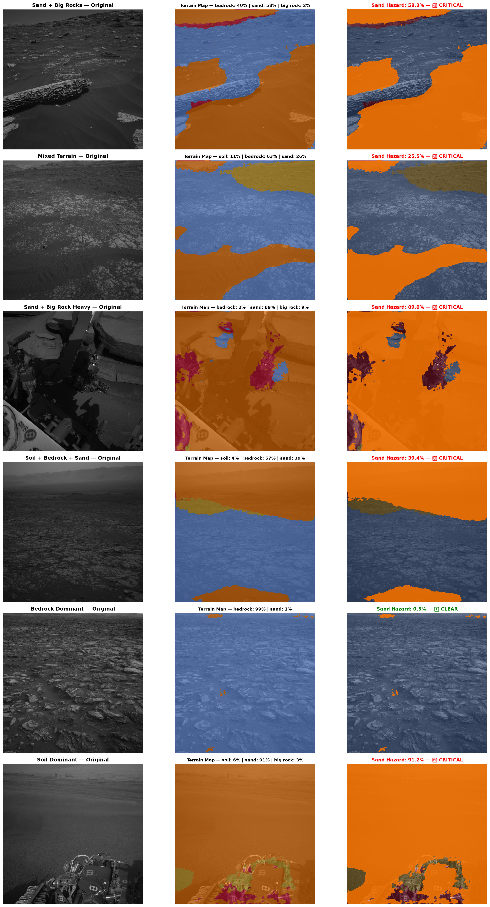

# 🔴 Mars Rover Terrain Segmentation (NASA JPL AI4Mars)
### Autonomous Driving Hazard Segmentation using DeepLabV3+ (ResNet-50)

[](https://www.python.org/)
[](https://pytorch.org/)
[](https://huggingface.co/datasets/hassanjbara/AI4MARS)
[](LICENSE)

An end-to-end deep learning system for pixel-level semantic segmentation of Martian terrain from NASA Mars Rover navigation cameras (**Navcam**, **Hazcam**, **Mastcam**), distinguishing driving hazards (**Sand**, **Big Rock**) from safe traction surfaces (**Soil**, **Bedrock**).

---

## 📌 Executive Summary & Resume Bullet

> **"Built a DeepLabV3+ terrain segmentation model on NASA JPL's AI4Mars dataset, reaching 67.1% mean IoU and 81.8% IoU on sand on expert-labeled Curiosity rover images (versus 12.8% and 0.0% for an all-soil baseline)."**

---

## 🛰️ Motivation: Why Terrain Segmentation Matters on Mars

On sol 1899 (May 2009), NASA's Mars Exploration Rover **Spirit** drove into a hidden deposit of soft, powdery iron-sulfate sand at a site named *"Troy"* inside Gusev Crater. The rover broke through a thin crust, became entrapped, and spun its wheels down to the axle. Despite nine months of intensive JPL sandbox simulations, Spirit could never be extracted and was permanently immobilized.

To keep rovers like **Curiosity** and **Perseverance** safe across thousands of sols, an autonomous rover must segment its immediate camera field of view in real time to avoid wheel sinkage and chassis high-centering.

---

## 🔬 Dataset Overview (NASA JPL AI4Mars)

- **Source:** [NASA JPL AI4Mars Dataset](https://data.nasa.gov/dataset/ai4mars-a-dataset-for-terrain-aware-autonomous-driving-on-mars) / [Hugging Face Repository](https://huggingface.co/datasets/hassanjbara/AI4MARS)
- **Scale:** ~35,000 images from Curiosity, Opportunity, and Spirit with ~326,000 crowdsourced labels and 1,500+ expert labels.
- **Classes:**
  - `0: Soil` — Compact regolith; safe driving surface.
  - `1: Bedrock` — Exposed rock pavement; firm, high-traction surface.
  - `2: Sand` — Soft sand ripples and dunes; **critical immobilization hazard**.
  - `3: Big Rock` — Rocks > 30 cm height & 50 cm width; **collision/high-center hazard**.
  - `255: Ignored` — Rover body, terrain beyond 30 m horizon, and unlabeled regions.
- **Expert Benchmark Splits:**
  - `test_min3`: 322 Curiosity rover images with unanimous consensus ($\ge 3$ rover drivers/geologists).
  - `test_min1`: 322 Curiosity rover images with agreement from $\ge 1$ expert.

---

## 🛠️ Pipeline & Architecture

```
[Raw Rover Navcam] ──> [Exclusion Masking] ──> [Data Augmentation] ──> [DeepLabV3+ (ResNet-50)]
  (1024x1024 RGB)        (Rover body + >30m)     (Sync Flips + Jitter)       (ASPP Module)
                                                                                  │
                                                                                  ▼
[Sand Hazard Alert] <── [Driving Safety Assessor] <── [Multiclass Prediction] <──┘
  (Wheel Sink Warning)     (Safe / Caution / Hazard)       (Argmax + Nearest Resize)
```

1. **Exclusion Masking:**
   - Volunteers were instructed to ignore the rover chassis and distant horizon (>30 m).
   - `rover_mask > 0` and `range_mask > 0` are strictly remapped to `255 (IGNORE)` so the model is not penalized for unannotated regions.
2. **Nearest-Neighbor Resizing:**
   - Masks are strictly resized with **nearest-neighbor interpolation** to prevent synthetic intermediate class artifacts.
3. **Class-Weighted Cross-Entropy:**
   - Because soil and bedrock represent ~85% of labeled pixels while sand (13.7%) and big rock (0.9%) are rare, weights are set inversely to class frequency as formulated by JPL:
     $$w_c = 1 - \frac{N_c}{N_{\text{total}}}$$
     $$\mathcal{W} = [0.6551, 0.4909, 0.8634, 0.9906]$$

---

## 📊 Experimental Results

### Expert Test Set Benchmark (`test_min3` — Unanimous Expert Agreement)

| Metric / Class | All-Soil Baseline | DeepLabV3+ (ResNet-50) | Relative Improvement |
| :--- | :---: | :---: | :---: |
| **Mean IoU (mIoU)** | **12.84%** | **67.09%** | **+54.25%** |
| **Pixel Accuracy** | **51.35%** | **92.48%** | **+41.13%** |
| **Soil IoU** | 51.35% | **87.18%** | +35.83% |
| **Bedrock IoU** | 0.00% | **89.26%** | +89.26% |
| **Sand IoU (Hazard)** | **0.00%** | **81.78%** | **+81.78%** |
| **Big Rock IoU** | 0.00% | **10.14%** | +10.14% |

### Relaxed Expert Test Set Benchmark (`test_min1` — Consensus $\ge 1$)

| Metric / Class | All-Soil Baseline | DeepLabV3+ (ResNet-50) | Relative Improvement |
| :--- | :---: | :---: | :---: |
| **Mean IoU (mIoU)** | **11.47%** | **57.74%** | **+46.28%** |
| **Pixel Accuracy** | **45.86%** | **86.35%** | **+40.48%** |
| **Soil IoU** | 45.86% | **79.97%** | +34.11% |
| **Bedrock IoU** | 0.00% | **75.21%** | +75.21% |
| **Sand IoU (Hazard)** | **0.00%** | **71.40%** | **+71.40%** |
| **Big Rock IoU** | 0.00% | **4.40%** | +4.40% |

> [!NOTE]
> **Why Pixel Accuracy is Misleading:**
> An all-soil trivial baseline achieves **51.35% pixel accuracy** on `test_min3` simply by guessing soil everywhere, yet detects **0.0% of sand hazards** and **0.0% of big rocks**. Multiclass Mean IoU and per-class Sand IoU are the honest engineering metrics.

> [!WARNING]
> **Big Rock Sample Sparsity:**
> Big rocks (>30 cm height) appear in very few test images (comprising only 77,698 pixels, or **0.07%** of the entire 322-image `test_min3` set). As noted in the AI4Mars paper, big rock scores fluctuate between runs due to extreme pixel rarity.

---

## 🔍 In-Depth Sand Error Analysis

Sand is the single most critical hazard for rover safety. We conducted a systematic failure-mode audit across all 107 test images containing sand hazards:

```
Total Sand Images Analyzed: 107
Mean Sand IoU: 79.11%
Error Breakdown of Missed Sand Pixels:
  - Confused as Bedrock:  95.68%
  - Confused as Soil:      2.75%
  - Confused as Big Rock:  1.57%
```

### Key Physical Failure Drivers:
1. **Thin Dust Mantle over Bedrock Fractures:** Thin sheets of sand settling into shallow fissures in fractured bedrock share identical basaltic albedo and low local variance, causing the model to predict Bedrock instead of Sand.
2. **Absence of Wind-Ripple Relief under High Solar Angles:** DeepLabV3+ relies heavily on transverse and barchan dune ripple crests. When sun angles are overhead and shadows disappear, low-relief sand sheets lose spatial texture.
3. **Horizon Distance Scale Dropoff:** Toward the 30-meter cutoff boundary, pixel resolution degrades, making sand ripple wavelength unresolvable.

---

## 🚀 Quickstart & Reproduction

### 1. Installation
```bash
git clone https://github.com/your-username/mars-rover-terrain-segmentation.git
cd mars-rover-terrain-segmentation

# Create virtual environment
python3 -m venv venv
source venv/bin/activate

# Install dependencies
pip install torch torchvision datasets segmentation-models-pytorch gradio matplotlib tqdm pyarrow
```

### 2. Download Targeted Datasets
```bash
python scripts/download_data.py
```

### 3. Data Exploration & Baseline Evaluation
```bash
# Generate exploratory visualizations
python scripts/explore_data.py

# Compute class weights and all-soil baseline
python scripts/compute_weights_and_baseline.py
```

### 4. Training
```bash
python src/train.py --epochs 5 --batch-size 8 --img-size 512
```

### 5. Final Evaluation & Error Analysis
```bash
# Evaluate on test_min3 and test_min1
python src/evaluate.py

# Run sand hazard error analysis
python src/error_analysis.py
```

### 6. Launch the Mission Control Telemetry Dashboard (Gradio)
```bash
python app.py
```
Open `http://localhost:7860` in your browser to launch the **NASA JPL Mission Control Telemetry Dashboard**.

#### 🛰️ Dashboard Capabilities:
- **🗺️ Multiclass Terrain Map:** Full-resolution semantic segmentation overlay (Soil, Bedrock, Sand, Big Rock) with opacity adjustment.
- **🚨 Sand Hazard Radar (Spirit Trap Alert):** Isolates loose sand dunes in high-contrast glowing amber, identifying wheel entrapment risks.
- **🧭 Traversability Costmap:** Renders the numerical costmap utilized by autonomous path planners ($A^* / D^*$):
  - 🟦 **Bedrock:** Lowest cost (firm pavement, maximum traction)
  - 🟩 **Soil:** Low cost (nominal driving)
  - 🟧 **Sand:** High cost (high wheel slip risk)
  - 🟥 **Big Rock:** Lethal obstacle (chassis collision hazard)
- **↔️ Side-by-Side Dual View:** Direct split comparison of raw camera frame vs model overlay with laser divider.
- **📊 Real-Time Telemetry HUD:**
  - Dynamic Drive Safety Status Banner (`🟢 DRIVE PERMITTED`, `🟡 CAUTION ADVISORY`, `🔴 EMERGENCY HALT & REPLAN`).
  - Traversability Confidence Index ($0 - 100$).
  - 4 Progress Meters with exact percentage breakdown and pixel counts.
  - Recommended Speed, Wheel Slip Estimate, and Steering Action.
- **💻 Flight Computer Console:** Monospace terminal displaying live simulated timestamped perception logs.

---

### 7. Standalone CLI Batch Prediction & Costmap Generator
Run inference and generate terrain overlays + JSON drive telemetry directly from the command line:
```bash
# Predict on a single image
python scripts/predict.py --input sample_images/test_rocky_terrain.jpg --output-dir outputs/

# Batch predict on an entire folder
python scripts/predict.py --input sample_images/ --output-dir outputs/ --resolution 512
```

---

### 8. Edge Robotics Deployment: TorchScript & ONNX Export
Export the DeepLabV3+ model for low-latency onboard robotic compute (NVIDIA Jetson, Edge TPU, ROS/ROS2 nodes):
```bash
python scripts/export_onnx.py --checkpoint checkpoints/best_deeplabv3plus.pth --output-dir checkpoints/
```

---

### 9. Docker Deployment
Launch the entire system inside a containerized environment with zero dependency conflicts:
```bash
docker compose up --build
```
Navigate to `http://localhost:7860` to access the Mission Control interface.

---

### 10. Run Unit & Integration Tests
Execute the comprehensive test suite verifying dataset loading, metric calculation, model architecture, and inference telemetry:
```bash
python -m unittest discover -s tests
```

---

## 🖼️ Multi-Terrain Test Results

Below is the multi-terrain benchmark across 6 diverse Martian scenes (sand dunes, boulder fields, mixed junctions, and solid rock shelves):



---

## 📓 Google Colab / Kaggle Training

A complete, self-contained notebook is available at [`notebooks/mars_rover_terrain_segmentation.ipynb`](notebooks/mars_rover_terrain_segmentation.ipynb). You can upload it to Google Colab, select a free **T4 GPU**, and train across the dataset in 15 minutes.

---

## 📂 Repository Structure

```
.
├── .github/workflows/ci.yml    # Automated GitHub Actions CI pipeline
├── Dockerfile                  # Multi-stage production container
├── docker-compose.yml          # Container orchestration (port 7860)
├── app.py                      # NASA JPL Mission Control Telemetry Dashboard (Gradio)
├── data/                       # Parquet datasets (train_shard0, test_min3, test_min1)
├── figures/                    # Generated confusion matrices, overlays, error maps
├── notebooks/                  # Google Colab / Kaggle reproducible notebook
├── sample_images/              # 18 curated Mars rover testing images
├── scripts/                    # Utility & deployment scripts
│   ├── predict.py              # Standalone CLI batch prediction & costmap generator
│   ├── export_onnx.py          # TorchScript & ONNX edge export utility
│   ├── download_data.py        # Dataset downloader
│   ├── explore_data.py         # Exploratory data analysis & figure generator
│   └── compute_weights_and_baseline.py
├── src/                        # Core Python library
│   ├── dataset.py              # Exclusion masks, preprocessing, PyTorch Dataset
│   ├── model.py                # DeepLabV3+ with ResNet-50 & Weighted CE Loss
│   ├── inference.py            # Standalone MarsTerrainSegmenter & telemetry engine
│   ├── metrics.py              # Confusion matrix, IoU per class, Pixel Accuracy
│   ├── train.py                # Full training & validation loop
│   ├── evaluate.py             # Evaluation on expert test splits
│   ├── error_analysis.py       # Sand failure mode analysis
│   └── visualization.py        # Color palettes, overlays, and diagnostic plots
└── tests/                      # Automated unit & integration test suite
    ├── test_dataset.py
    ├── test_metrics.py
    ├── test_model.py
    └── test_inference.py
```

---

## 📄 References & Acknowledgments
- **NASA JPL AI4Mars Paper:** Swan et al., *"AI4MARS: A Dataset for Terrain-Aware Autonomous Driving on Mars"*, IEEE Aerospace Conference, 2021.
- **Segmentation Models PyTorch:** [qubvel/segmentation_models.pytorch](https://github.com/qubvel/segmentation_models.pytorch)
- **NASA Jet Propulsion Laboratory (JPL):** Planetary Data System (PDS) Mars Science Laboratory (MSL) Curiosity Mission.

