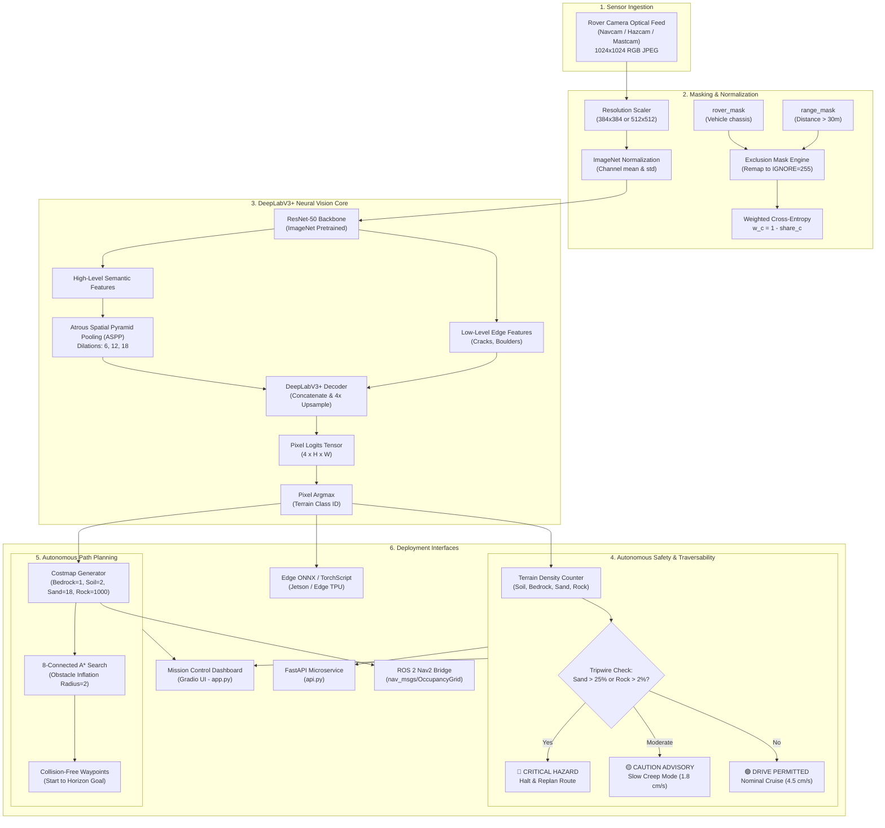

# 🏗️ System Architecture & Engineering Design

This document details the software architecture, data flow, neural perception pipeline, and autonomous decision engine for the **NASA JPL Mars Rover Terrain Segmentation & AutoNav System**.

---

## 1. High-Level System Architecture

---

## 2. Core Modules

| Module | Location | Responsibility |
| :--- | :--- | :--- |
| **Dataset Loader** | [`src/dataset.py`](../src/dataset.py) | Parquet ingestion, exclusion masks (`rover_mask`, `range_mask`), nearest-neighbor resizing, PyTorch Dataset. |
| **Neural Backbone** | [`src/model.py`](../src/model.py) | DeepLabV3+ model creation with ResNet-50 encoder, weighted cross-entropy loss. |
| **TTA Ensemble** | [`src/tta.py`](../src/tta.py) | Geometric & photometric multi-view Test-Time Augmentation probability averaging (`fast`/`full`). |
| **Inference Engine** | [`src/inference.py`](../src/inference.py) | Standalone segmenter, overlay generator, density metrics, drive status rules. |
| **Terramechanics Engine** | [`src/terramechanics.py`](../src/terramechanics.py) | Bekker-Wong wheel sinkage depth, slip ratio, and motor torque estimation. |
| **MMRTG Power Estimator** | [`src/power_budget.py`](../src/power_budget.py) | Continuous 110W RTG & Li-Ion battery mobility energy draw (`Wh/m`, thermal alerts). |
| **Uncertainty Estimator** | [`src/uncertainty.py`](../src/uncertainty.py) | Pixelwise Shannon entropy heatmaps and perception confidence auditing. |
| **Field Report Generator** | [`src/report_generator.py`](../src/report_generator.py) | Self-contained HTML Sol Drive Engineering Field Report compiler. |
| **A* Path Planner** | [`src/path_planner.py`](../src/path_planner.py) | 8-connected A* heuristic search, obstacle inflation, trajectory rendering. |
| **ROS 2 Bridge** | [`src/ros_bridge.py`](../src/ros_bridge.py) | `nav_msgs/OccupancyGrid` serialization for ROS 2 Nav2 costmaps. |
| **Evaluation Suite** | [`src/evaluate.py`](../src/evaluate.py) | Benchmark evaluation against `test_min3` and `test_min1` consensus test sets. |
| **Error Diagnostics** | [`src/error_analysis.py`](../src/error_analysis.py) | Sand-to-bedrock confusion analysis and diagnostic image generation. |
| **Gradio Dashboard** | [`app.py`](../app.py) | NASA JPL Mission Control Telemetry HUD with TTA controls & report export. |
| **REST Microservice** | [`api.py`](../api.py) | Production FastAPI microservice for ground station and robot client integration. |

---

## 3. Traversability & Costmap Calibration

Path planners ($A^*$, $D^*$, and ROS Nav2) require numerical cost assignments to plan collision-free, energy-efficient routes:

$$\text{Cost}(p) = \text{TerrainWeight}(\text{Class}_p) \times \text{MovementDistance}$$

| Class | Description | Traversal Cost | Navigation Role |
| :---: | :--- | :---: | :--- |
| **1: Bedrock** | Exposed solid rock shelf | **1.0** | Preferred driving surface. Maximum traction, zero wheel slip. |
| **0: Soil** | Compact Martian regolith | **2.0** | Safe driving. Nominal drive speed. |
| **2: Sand** | Loose sand dunes & ripples | **18.0** | Extreme penalty. Avoided unless no viable alternative exists. |
| **3: Big Rock** | Boulders taller than 30 cm | **1000.0** | Lethal obstacle. Inflated by buffer radius to protect rover chassis. |
| **255: Ignored** | Chassis / distant horizon | **1000.0** | Untraversable boundary. |

