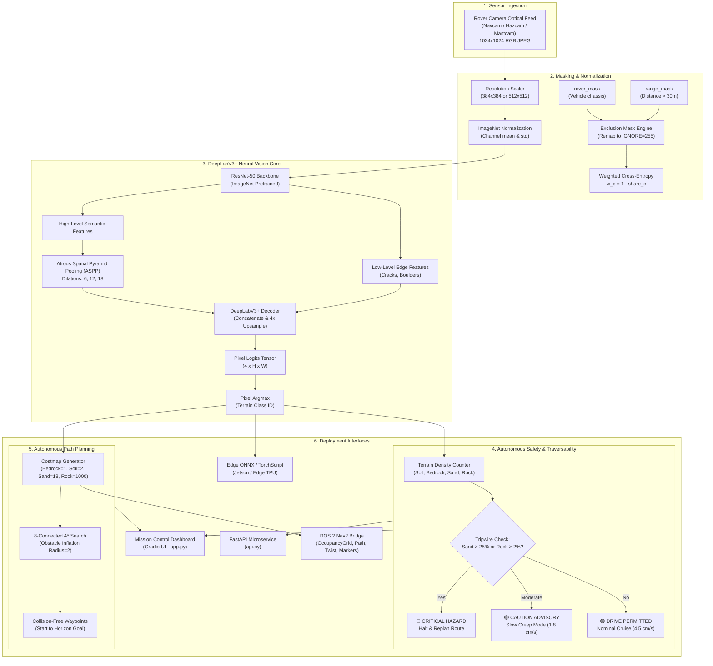

# 🏗️ System Architecture & Engineering Design

This document details the software architecture, data flow, neural perception pipeline, and autonomous decision engine for the **NASA JPL Mars Rover Terrain Segmentation & AutoNav System**.

---

## 1. High-Level System Architecture

---

## 2. Core Modules

| Module | Location | Responsibility |
| :--- | :--- | :--- |
| **Dataset Loader** | [`src/dataset.py`](../src/dataset.py) | Parquet ingestion, exclusion masks (`rover_mask`, `range_mask`), nearest-neighbor resizing, PyTorch Dataset. |
| **Neural Backbone** | [`src/model.py`](../src/model.py) | DeepLabV3+ model creation with ResNet-50 encoder, weighted cross-entropy loss. |
| **TTA Ensemble** | [`src/tta.py`](../src/tta.py) | Geometric & photometric multi-view Test-Time Augmentation probability averaging (`fast`/`full`). |
| **Inference Engine** | [`src/inference.py`](../src/inference.py) | Standalone segmenter, overlay generator, density metrics, drive status rules. |
| **Optical Watchdog** | [`src/sensor_watchdog.py`](../src/sensor_watchdog.py) | Optical frame glare, dust haze, blur, and dark-frame health diagnostics with TTA boost triggers. |
| **Terramechanics Engine** | [`src/terramechanics.py`](../src/terramechanics.py) | Bekker-Wong wheel sinkage depth, slip ratio, and motor torque estimation. |
| **Slope Stability** | [`src/slope_stability.py`](../src/slope_stability.py) | Rover pitch/roll rollover safety margin, grade resistance, and coupled regolith slip. |
| **Geometry Risk Radar** | [`src/geometry_risk.py`](../src/geometry_risk.py) | Perspective range-zone breakdown (0-5m/5-15m/15-30m), boulder clustering, and high-centering risk. |
| **Steering Kinematics** | [`src/kinematics.py`](../src/kinematics.py) | Ramer-Douglas-Peucker trajectory simplification, Ackermann turn maneuvers, and drive durations. |
| **AEGIS Science Targeting** | [`src/science_targets.py`](../src/science_targets.py) | Autonomous geological outcrop/contact target ranking and optical reticle rendering. |
| **MMRTG Power Estimator** | [`src/power_budget.py`](../src/power_budget.py) | Continuous 110W RTG & Li-Ion battery mobility energy draw (`Wh/m`, thermal alerts). |
| **Sol Mission Simulator** | [`src/sol_simulator.py`](../src/sol_simulator.py) | Multi-waypoint Sol Li-Ion battery SoC cycles, slip odometry drift, and hazard/low-battery aborts. |
| **Uncertainty Estimator** | [`src/uncertainty.py`](../src/uncertainty.py) | Pixelwise Shannon entropy heatmaps and perception confidence auditing. |
| **Probability Calibrator** | [`src/calibration.py`](../src/calibration.py) | Temperature scaling, ECE scoring, and conformal borderline sand hazard recall overlay. |
| **Field Report Generator** | [`src/report_generator.py`](../src/report_generator.py) | Self-contained HTML Sol Drive Engineering Field Report compiler. |
| **A* Path Planner** | [`src/path_planner.py`](../src/path_planner.py) | 8-connected A* heuristic search, obstacle inflation, trajectory rendering. |
| **Costmap Fusion Engine** | [`src/costmap_fusion.py`](../src/costmap_fusion.py) | Multi-layer AutoNav 2D costmap fusion integrating semantic traversability, slope resistance, uncertainty risk, and ventifact wear. |
| **Wheel Wear Mechanics** | [`src/wheel_wear.py`](../src/wheel_wear.py) | Ventifact micro-relief roughness, 0.75mm aluminum wheel contact stress, puncture fatigue, and abrasive wear. |
| **Solar-Thermal Model** | [`src/solar_thermal.py`](../src/solar_thermal.py) | Diurnal solar insolation flux, dust optical depth ($\tau$) extinction, surface temperatures, and survival heater power. |
| **Stereo Geometry Engine** | [`src/stereo_geometry.py`](../src/stereo_geometry.py) | Navcam stereo baseline disparity, metric depth, 3D positive step obstacles (>25cm), negative drop-off trenches (>35cm), and belly ground clearance envelopes. |
| **Aeolian Drift Model** | [`src/aeolian_drift.py`](../src/aeolian_drift.py) | Boundary-layer wind friction velocity, Bagnold-White sand saltation mass flux, dune lee-side angle of repose ($34^\circ$) slipface avalanche entrapment, and cross-wind heading optimization. |
| **DSN Telemetry Manager** | [`src/dsn_telemetry.py`](../src/dsn_telemetry.py) | 4-tier flight data packetization (P1–P4), Direct-to-Earth X-band vs. MRO/TGO Electra UHF relay pass link budgets, and LTST orbiter pass scheduling. |
| **Visual Odometry Model** | [`src/visual_odometry.py`](../src/visual_odometry.py) | FAST/gradient peak visual feature tracking, terrain class anchor grounding, visual ground displacement measurement, and wheel slip compensation. |
| **DWA Local Planner** | [`src/dwa_local_planner.py`](../src/dwa_local_planner.py) | Dynamic Window Approach velocity search window, circular arc lookahead rollouts, clearance scoring, and reactive local collision avoidance. |
| **Dust Accumulation Model** | [`src/dust_accumulation.py`](../src/dust_accumulation.py) | Diurnal dust settling rate, optical window transmittance degradation, contrast loss, and convective vortex ("dust devil") cleaning resets. |
| **VO Slip Audit CLI** | [`scripts/audit_visual_odometry.py`](../scripts/audit_visual_odometry.py) | Standalone CLI auditing visual keypoint tracking, wheel slip ratios, and annotated vector overlays across flight imagery. |
| **Stereo 3D Audit CLI** | [`scripts/audit_stereo_geometry.py`](../scripts/audit_stereo_geometry.py) | Fleet-wide CLI auditing 3D step hazards and belly ground clearance across navigation imagery. |
| **ROS 2 Bridge** | [`src/ros_bridge.py`](../src/ros_bridge.py) | `OccupancyGrid`, `Path`, `Twist`, and RViz2 `MarkerArray` payload serialization for ROS 2 Nav2. |
| **Evaluation Suite** | [`src/evaluate.py`](../src/evaluate.py) | Benchmark evaluation against `test_min3` and `test_min1` consensus test sets. |
| **Error Diagnostics** | [`src/error_analysis.py`](../src/error_analysis.py) | Sand-to-bedrock confusion analysis and diagnostic image generation. |
| **Gradio Dashboard** | [`app.py`](../app.py) | NASA JPL Mission Control Telemetry HUD with TTA controls & report export. |
| **REST Microservice** | [`api.py`](../api.py) | Production FastAPI microservice for ground station and robot client integration. |

---

## 3. Traversability & Costmap Calibration

Path planners ($A^*$, $D^*$, and ROS Nav2) require numerical cost assignments to plan collision-free, energy-efficient routes:

$$\text{Cost}(p) = \text{TerrainWeight}(\text{Class}_p) \times \text{MovementDistance}$$

| Class | Description | Traversal Cost | Navigation Role |
| :---: | :--- | :---: | :--- |
| **1: Bedrock** | Exposed solid rock shelf | **1.0** | Preferred driving surface. Maximum traction, zero wheel slip. |
| **0: Soil** | Compact Martian regolith | **2.0** | Safe driving. Nominal drive speed. |
| **2: Sand** | Loose sand dunes & ripples | **18.0** | Extreme penalty. Avoided unless no viable alternative exists. |
| **3: Big Rock** | Boulders taller than 30 cm | **1000.0** | Lethal obstacle. Inflated by buffer radius to protect rover chassis. |
| **255: Ignored** | Chassis / distant horizon | **1000.0** | Untraversable boundary. |

### 3.1 Multi-Layer AutoNav Costmap Fusion
The composite 2D navigation costmap $C(r, c)$ fuses multiple physical and perception layers:
$$C(r, c) = w_{\text{sem}} C_{\text{base}}(r, c) + w_{\text{slope}} \Delta C_{\text{slope}}(r, c) + w_{\text{uncert}} H(r, c) + w_{\text{wear}} P_{\text{wear}}(r, c) + C_{\text{inflate}}(r, c)$$
- **Base Semantic Cost:** Maps class IDs using base weights (Bedrock: 1.0, Soil: 2.0, Sand: 18.0, Rock: 1000.0).
- **Slope Resistance:** Scales with combined pitch and roll tilt magnitude $\|\mathbf{\theta}\|$, penalizing uphill progress towards upper horizon rows.
- **Uncertainty Buffer:** Shannon entropy $H(r, c)$ adds repulsive potential around borderline decision boundaries.
- **Ventifact Protection:** When bedrock exhibits sharp micro-relief, adds modest penalty to divert rovers onto smooth regolith.
- **Obstacle Inflation:** Multi-cell circular dilation around boulders (class 3) enforcing keep-out envelopes for chassis safety.

---

## 4. Curiosity/Perseverance Aluminum Wheel Wear Mechanics
Curiosity and Perseverance traverse Martian terrain with 0.75 mm thin machined 6061-T6 aluminum wheels. Sharp wind-sculpted ventifacts concentrate rover weight onto 1–3 mm asperities:
- **Surface Roughness Index:** Discrete spatial gradient magnitude on bedrock and rocks:
  $$R_{\text{ventifact}} = \text{clip}\left(\frac{\bar{G}_{\text{hard}} - 2.0}{18.0} \times 100, 0, 100\right)$$
- **Contact Point Stress:**
  $$\sigma_{\text{contact}} = \sigma_{\text{base}} + \left(\frac{\%_{\text{bedrock}} + 1.5 \%_{\text{rock}}}{100}\right) \left(180 \frac{R}{100} + 45\right) \left(1 + \frac{s}{40} \times 1.5\right)$$
- **Yield Ratio & Puncture Fatigue:** When $\sigma_{\text{contact}} \ge \sigma_{\text{yield}} = 276.0\,\text{MPa}$, skin yield and puncture fatigue probability spikes, triggering strict traction control.
- **Abrasive Wear Rate:** Governs skin thinning ($\mu\text{m/km}$) across soft sand polishing (10–25 $\mu\text{m/km}$) vs. razor ventifact gouging (150–500 $\mu\text{m/km}$).

---

## 5. Martian Diurnal Solar Insolation & Thermal Survival Model
Predicts available optical flux and rover survival heater demand under atmospheric dust:
- **Beer-Lambert Extinction:** Total surface irradiance at solar elevation $\theta_{\text{elev}}$ and dust opacity $\tau$:
  $$I_{\text{total}} = S_{\text{Mars}} \sin(\theta_{\text{elev}}) \left[e^{-\tau / \sin(\theta_{\text{elev}})} + 0.28 (1 - e^{-\tau / \sin(\theta_{\text{elev}})}) \frac{1}{1 + 0.3 \tau}\right]$$
- **Diurnal Surface Temperature:** Cosine diurnal temperature wave with peak at 13:30 LTST, dampened by atmospheric dust scattering.
- **Battery Survival Heaters:** Automatically calculates electrical draw up to 35 W when effective chassis temperatures fall below $-35^\circ\text{C}$.

---

## 6. Navcam Stereo 3D Disparity & Elevation Step Hazard Geometry
Models the flight-proven stereo camera geometry utilized by Mars Science Laboratory (Curiosity) and Mars 2020 (Perseverance) Navigation Cameras (Navcams):
- **Stereo Baseline & Disparity:**
  Given a stereo optical baseline $b = 0.424\,\text{m}$ and focal length $f = 1400\,\text{px}$, pixel disparity $d(r, c)$ maps directly to metric radial range $Z(r, c)$:
  $$d(r, c) = \frac{f \cdot b}{Z(r, c)}$$
- **Perspective Elevation Relief:**
  Differential elevation gradients $\Delta Z$ are calculated using discrete differential Sobel/Scharr operators, scaled by local class density:
  - Big Rocks (class 3) generate prominent positive vertical step relief ($+15\,\text{cm}$ to $+55\,\text{cm}$).
  - Sand ripples (class 2) produce soft rolling undulations ($+5\,\text{cm}$ to $+15\,\text{cm}$).
  - Solid bedrock (class 1) exhibits sharp planar fracture steps.
- **Flight Safety Step Limits:**
  - Positive vertical step obstacle threshold: $> 25.0\,\text{cm}$ (critical limit for Curiosity-class 50 cm wheels; exceeds rocker-bogie climbing capability).
  - Negative drop-off trench threshold: $> 35.0\,\text{cm}$ (extreme tipover / wheel drop risk).
  - Belly Ground Clearance Envelope: $60.0\,\text{cm}$ nominal chassis clearance; tracks minimum margin to prevent center-underbody high-centering.

---

## 7. Martian Atmospheric Aeolian Sand Saltation & Dune Slipface Mechanics
Simulates Martian atmospheric boundary layer aeolian sand transport in thin 6 mbar $CO_2$ atmosphere ($\rho \approx 0.015\,\text{kg/m}^3$):
- **Boundary-Layer Friction Velocity:**
  $$u_* = \kappa \frac{u(z)}{\ln(z / z_0)}$$
  where von Kármán constant $\kappa \approx 0.40$, aerodynamic roughness length $z_0 \approx 0.001\,\text{m}$, and $z = 1.6\,\text{m}$ (rover mast anemometer height).
- **Martian Threshold Saltation Velocity:**
  Due to low Martian atmospheric density, threshold friction velocity is significantly higher than on Earth:
  $$u_{*t} \approx 1.45\,\text{m/s} \quad (\approx 20\text{–}25\,\text{m/s at mast height})$$
- **Bagnold-White Sand Mass Flux:**
  $$q = C_w \frac{\rho_{\text{atm}}}{g} u_* (u_* - u_{*t})(u_* + u_{*t}) \quad \text{for } u_* > u_{*t}$$
- **Dune Lee-Side Slipface Avalanche Entrapment:**
  Active Martian ripples and barchan dunes form unstable lee-side slipfaces at the angle of repose ($\theta_{\text{repose}} \approx 34^\circ$).
  When the rover travels downwind onto a loose lee slope, sinkage and avalanche entrapment risk escalates dramatically. The slipface risk index is modeled as:
  $$R_{\text{slip}} = \text{clip}\left(S_{\text{sand}} \times \left(0.40 + 0.60 \times \frac{1 - \cos(\theta_{\text{heading}} - \theta_{\text{wind\_origin}})}{2}\right) \times \left(1 + \frac{q}{5.0}\right), 0, 100\right)$$
- **Optimal Crossing Heading:** Heading perpendicular to wind streamlines ($\pm 90^\circ$ cross-wind) to traverse dune crests at maximum shear stability.

---

## 8. NASA Deep Space Network (DSN) Multi-Priority Telemetry Link Budget
Models mission telemetry downlink scheduling across direct-to-Earth (DTE) and proximity relay orbiters:
- **Priority Queue Hierarchy:**
  - **P1: Critical Safety & Fault Alerts** ($< 2\,\text{kB}$, mandatory $< 5\,\text{s}$ downlink latency).
  - **P2: AEGIS Science Target Spectra & Regolith Telemetry** ($5\text{–}20\,\text{kB}$).
  - **P3: Nav2 Fused Costmaps & A\* Global Waypoint Paths** ($15\text{–}60\,\text{kB}$).
  - **P4: Compressed Optical Camera Overlays** ($150\text{–}800\,\text{kB}$).
- **Comms Link Budget:**
  - **Direct-to-Earth (DTE) X-Band:** Deep Space Network 34m/70m beamwidth, nominal $16\,\text{kbps}$, useful during daytime rover cruise.
  - **UHF Electra Proximity Relay:**
    - Mars Reconnaissance Orbiter (**MRO**): $2048\,\text{kbps}$, 480 s pass duration.
    - Trace Gas Orbiter (**TGO**): $2048\,\text{kbps}$, 540 s pass duration.
    - 2001 Mars Odyssey (**ODY**): $256\,\text{kbps}$, 600 s pass duration.
- **Orbiter Overflight Pass Scheduling:**
  Calculates time to next overhead pass relative to rover Local True Solar Time (LTST), flagging imminent relay windows for buffer staging.

---

## 9. Visual Odometry (VO) Feature Grounding & Slip Compensation
Mars rovers like Opportunity, Curiosity, and Perseverance rely on visual odometry to detect insidious wheel slip where wheel encoders continue turning while the vehicle remains stationary (such as during Spirit's entrapment at Troy).
- **Terrain-Grounded Feature Extraction:**
  Keypoints are extracted from local spatial gradient peaks across the navigation frame and grounded against neural semantic masks:
  - **Bedrock (Class 1):** Solid rock anchor features assigned maximum trust ($w = 1.00$).
  - **Soil (Class 0):** Compact regolith features assigned high trust ($w = 0.85$).
  - **Sand (Class 2):** Loose ripple features down-weighted to low trust ($w = 0.20$), because aeolian saltation and rolling sand particles create false slip illusions.
- **Visual Ground Displacement:**
  Tracks true displacement over commanded wheel revolution distance $d_{\text{wheel}}$:
  $$d_{\text{VO}} = d_{\text{wheel}} \cdot (1 - s_{\text{eff}})$$
- **Wheel Slip Estimation & Error Delta:**
  $$s = \max\left(0.0, 1.0 - \frac{d_{\text{VO}}}{d_{\text{wheel}}}\right) \times 100\%$$
  $$\Delta d = d_{\text{wheel}} - d_{\text{VO}}$$
- **Safety Tripwire Escalation:**
  - $s \ge 40\%$: Triggers `CRITICAL_WHEEL_SLIPPAGE`, forcing autonomous halt and route replan.
  - $s \ge 20\%$: Triggers `MODERATE_SLIP_CAUTION`, engaging slow creep drive mode.
  - Sand feature dominance ($>60\%$ sand keypoints): Flags `VO_SAND_DECEPTION_WARNING` advisory.

---

## 10. Dynamic Window Approach (DWA) Reactive Collision Avoidance Planner
While $A^*$ generates global waypoints across the full 30 m horizon, the onboard flight computer evaluates local reactive trajectories at 5 Hz using the Dynamic Window Approach (Fox et al., 1997) parameterized for slow planetary rovers ($v_{\max} = 4.5\,\text{cm/s}$):
- **Velocity Search Space & Dynamic Window:**
  Constrained by rover actuator motor acceleration limits ($\dot{v} \le 2.0\,\text{cm/s}^2, \dot{\omega} \le 6.0^\circ/\text{s}^2$):
  $$V_d = [v_c - \dot{v}\Delta t, v_c + \dot{v}\Delta t] \cap [-\dot{\omega}\Delta t, \dot{\omega}\Delta t] \cap [0, v_{\max}] \times [-\omega_{\max}, \omega_{\max}]$$
- **Circular Arc Rollouts & Near-Field Lookahead:**
  Simulates circular arc forward integration parameterized across lookahead distance ($L = 3.5\,\text{m}$) using trajectory curvature $\kappa = \omega / v$:
  $$x(s) = \frac{1}{\kappa} \sin(\kappa s), \quad y(s) = \frac{1}{\kappa} (1 - \cos(\kappa s)) \quad (\text{for } \kappa \ne 0)$$
- **Multi-Objective Cost Evaluation:**
  $$G(v, \omega) = \alpha \cdot \text{heading\_score}(v, \omega) + \beta \cdot \text{clearance\_score}(v, \omega) + \gamma \cdot \text{velocity\_score}(v)$$
  where $\alpha = 0.40, \beta = 0.45, \gamma = 0.15$.
  Any trajectory arc that intersects Big Rocks (Class 3) or dense Sand Dunes (Class 2) is assigned an immediate veto score of $-100.0$ and discarded.
- **Steer Actions:**
  Generates discrete command actions: `FORWARD_NOMINAL`, `STEER_GENTLE_RIGHT`, `STEER_HARD_LEFT`, `SLOW_CREEP_AVOIDANCE`, or `HALT_NO_ADMISSIBLE_PATH`.

---

## 11. Diurnal Martian Atmospheric Dust Deposition & Lens Transmittance Degradation
Atmospheric dust settling is a primary degradation mechanism for Mars surface missions (responsible for the termination of InSight, Opportunity, and Spirit).
- **Sol-by-Sol Settling Rate:**
  Base settling rate $r_0 = 0.18\%/\text{sol}$ scaled by prevailing atmospheric optical depth $\tau$:
  $$r_{\text{dust}} = r_0 \times \left(1.0 + 0.6 \frac{\tau - 0.5}{1.0}\right)$$
- **Beer-Lambert Lens Transmittance Decay:**
  $$T_{\text{opt}}(\Delta\text{sol}) = T_0 \cdot \exp(-0.0028 \cdot \Delta\text{sol})$$
- **Dust Layer Thickness & Contrast Attenuation:**
  Tracks accumulated dust layer thickness in microns ($\mu\text{m}$) and models forward scattering veiling glare that reduces image contrast:
  $$C_{\text{loss}} = \text{clip}\left(\frac{\text{thickness}_{\mu\text{m}}}{2.5} \times 100\%, 0\%, 80\%\right)$$
- **Convective Cleaning Vortex ("Dust Devil") Probability:**
  Evaluates probability of an atmospheric convective vortex sweeping the rover deck and clearing optics:
  $$P_{\text{vortex}} = \text{clip}\left(1.5\% \times \left(\frac{u_{\text{wind}}}{10.0}\right) \times \left(\frac{1.0}{\tau}\right), 0.1\%, 12.0\%\right)$$

